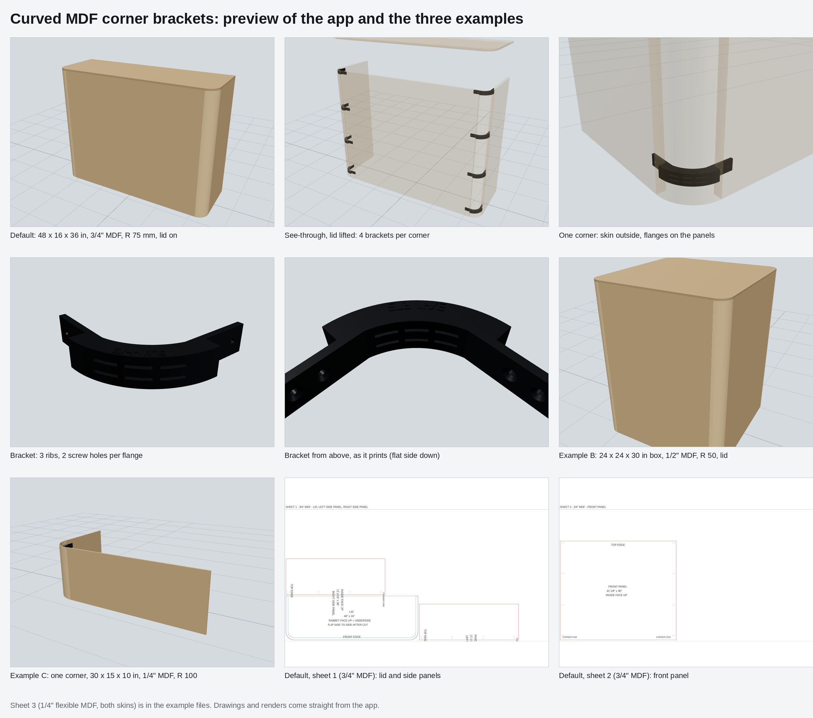

# Curved MDF corner bracket generator

A browser app for building MDF cabinets and boxes with rounded corners. Flat MDF panels meet at a curved corner. 3D-printed brackets hold the panels, and a strip of flexible MDF bends around the brackets to make the curved face. The app draws the whole assembly in 3D, and it writes the print files for the brackets and the CNC files for the boards.

**Open the app:** https://allowistic.github.io/curved-bracket-generator/

It's one self-contained HTML file (`index.html`) with everything built in, so it also works offline. Download it and open it in any modern browser. The only thing that needs the https link is the room view on Quest and Android (see AR below).

The design follows a Perth Fireplaces reel (@perthfireplaces): a quarter-ring bracket with a flat flange at each end, screwed to the inside faces of the panels, with a separate flexible MDF skin over the curve. The brief came from Aya and Muse; the build is by Miles.

## Using the sliders

Every setting is a slider, and the 3D view updates while you drag. Each size also has a box you can type an exact value into: `36`, `36.5`, `36 1/2`, `36-1/2`, or a unit on the end (`914mm`, `91.4cm`, `36"`). A value outside a slider's range is set to the nearest end, and the app says so.

- **Layout (buttons):** `L` is one corner, `U` is two front corners with an open back, and `box` is four corners.
- **Size:** length, depth and height of the outside of the box. Switch between inches and mm at the top.
- **Corner radius:** 25 to 200 mm, with quick buttons for 50, 75 and 100 mm. The default is 75 mm, from the reel's caption.
- **Board thickness:** 1/4", 1/2", 16 mm (the reel) or 3/4" MDF.
- **Skin thickness:** 1/8", 1/4" or 3/8" flexible MDF.
- **Brackets per corner** and **end bracket in from the edge:** the brackets spread evenly between the end margins.
- **Lid:** on or off, with its clearance, thickness, plug (rabbet) depth and overhang.
- **Bracket shape settings:** band width, bracket width, flange length and thickness, and the slot between the three ribs (0 = solid), for fine-tuning the printed part.

In the 3D view, **See-through** shows the brackets inside the panels, **Lift lid** raises the lid so you can see the plug, and **Reset view** frames the model again.

## On a phone

The same link works on phones. Nothing is left out.

- **Portrait:** the 3D view sits on top and the settings are in a sheet along the bottom. Drag the handle (or tap it) to move the sheet between three heights: pulled down for a nearly full-screen 3D view, halfway, or pulled up to see all the settings. The view buttons sit along the bottom of the 3D view.
- **Landscape:** the settings are in a narrow drawer on the left. **Sliders** folds it away for a full-width view.
- **3D view:** one finger turns it, pinch to zoom, two fingers to move it.
- **Typing a size:** tap the value next to a slider. The number keyboard comes up.
- **Files:** each download saves to Files (iPhone) or Downloads (Android). On phones that can share files there's also **Share everything (zip)**, to send the zip to Drive, AirDrop or the shop computer.

## Downloads

**Print and cut files** downloads a zip made from the sliders as they're set:

- the bracket STL, lying flat the way it prints
- an X1C 3MF plate (256 x 256 bed) with as many brackets as fit, and how many times to print it
- one DXF and one SVG per 4 x 8 sheet, for VCarve
- a cut list with part sizes, screw count, bracket positions and print estimates

DXF layers for VCarve:

- `PROFILE_THROUGH_CUT`: part outlines. Cut them on the outside.
- `POCKET_LID_RABBET_<depth>_DEEP`: the lid outline plus the plug outline inside it. Pocket the ring between them. The lid is drawn as seen from below.
- `DRILL_PILOT_<dia>_DIA_<depth>_DEEP`: optional pilot holes for the bracket screws on the panels' inside faces.
- `LABELS_NOCUT` and `SHEET_48x96_NOCUT`: part names and the sheet outline. Don't toolpath these.

The file units are set in each DXF header (`$INSUNITS`).

## AR room view

**View in my room** puts the box, full size, on your floor.

- **Quest 3 and Android (Chrome):** WebXR room view. It only starts from the https link above, not from a downloaded file.
- **iPhone and iPad:** Safari has no WebXR, so the room view opens in Apple's AR Quick Look, at real size (the model is made when the dialog opens, so the button opens it straight away). **Download USDZ** saves the same model. Both work from a downloaded file too.

## The lid

The lid is cut from MDF on the CNC, not printed, because it's far bigger than a printer bed. A rabbet routed on its underside leaves a plug that drops inside the panels with the clearance you set on each walled side. The plug rests on the top bracket in each corner, because the top bracket is placed exactly at the plug depth. The plug's corners curve around the same centre as the skin, so they can't catch where the skin meets a panel.

## Before you cut

- **Fit test:** print one bracket and test it against a panel offcut and a strip of skin before running full sheets.
- **Slots:** the slicer flags the roofs of the bracket slots as long bridges. If they print rough, set the slot slider to 0 for a solid band.
- **Skin fastening:** the reel didn't show how the skin is fastened, so glue it to the bands and to the panel ends. Don't screw through the skin.
- **1/4" panels:** too thin for screws, so no pilot holes are drawn and those brackets get glued.

## Assumptions the brief left open

- Outside radius 75 mm by default (the reel's caption).
- The bracket's look comes from the reel; the sizes were chosen: a 16 mm band, 22 mm wide along the corner, 40 mm flanges 5 mm thick, two 2 mm slots between three ribs, two 4.2 mm countersunk holes per flange, and a raised size marking.
- Screws: #8 flat-head wood screws, picked so they stop at least 3 mm short of the outside face.
- With a lid, the top bracket moves up under the plug.
- Nesting is simple shelf packing, with 1/2" kept clear at the sheet edges and between parts. VCarve Pro's own nesting may fit parts onto fewer sheets.

## What's in this repo

- `index.html`: the app.
- `scripts/`: the same parts without a browser. `curved_bracket.scad` is one bracket in OpenSCAD (use the Customizer, then export the STL). `curved_parts.py` writes the DXFs, the bracket STL (through OpenSCAD) and the cut list from the command line; it needs `pip install ezdxf`. See `scripts/README.md` for options and examples.
- `examples/default_U_48x16x36in_R75_lid/`: the default job, 48 x 16 x 36 in, U layout, 3/4" MDF, 75 mm radius, lid on. It needs 8 brackets at 4 per plate, so print the 3MF twice. Each bracket sliced in PrusaSlicer at about 1 hour 17 minutes and 36 g of PETG (0.4 mm nozzle, 0.2 mm layers, 4 walls, 40% gyroid, no supports). The boards nest on three sheets: two of 3/4" MDF and one of 1/4" flexible MDF. `params.json` holds the exact settings.
- `examples/preview_sheet.png`: renders of three example jobs.

## Credits and licences

This project is MIT licensed (see `LICENSE`). `index.html` embeds these libraries, each under its own licence; the full texts are in `THIRD_PARTY_LICENSES.txt` and in the app's **Credits and licences** panel:

- [three.js](https://github.com/mrdoob/three.js) r170, MIT, for the 3D view, the WebXR room view and the USDZ export
- [manifold-3d](https://github.com/elalish/manifold) 3.5.5, Apache License 2.0, for building the bracket solid
- [fflate](https://github.com/101arrowz/fflate) 0.8.3, MIT, for the zip and 3MF files

Bracket design inspired by a Perth Fireplaces reel. Made for Vincent Strader's shop, part of The Allowistic Way.
